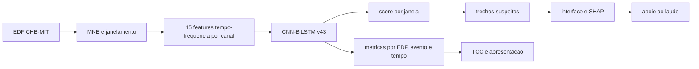

# Mapa do projeto

## Camadas

- **Dados:** EDFs CHB-MIT com anotacoes oficiais de crise.
- **Processamento:** MNE-Python, janelas temporais e normalizacao baseada somente no treino.
- **Representacao:** caracteristicas espectrais e temporais por canal; a v43 nao usa o sinal bruto diretamente como entrada principal.
- **Modelo:** CNN-BiLSTM com fusao tardia dos canais e saida temporal.
- **Pos-processamento:** threshold, duracao minima e uniao de lacunas para formar eventos.
- **Aplicacao:** FastAPI, React/TypeScript, PostgreSQL na configuracao final e visualizacao multicanal.
- **Explicabilidade:** Gradient SHAP associado as janelas de features da sequencia de pico.

## Relacoes importantes

- [[02 - Estado atual v43]] e a referencia oficial congelada.
- [[03 - Experimento v57]] mostra uma tentativa posterior que nao deve substituir a v43.
- [[04 - TCC e evidencias]] transforma os resultados em narrativa academica transparente.
